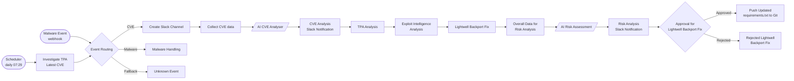

# DemoJam-2027 — AI-assisted CVE remediation with Automation Orchestrator, Trusted Profile Analyzer and Lightwell

An Automation Orchestrator (AO) workflow that takes a new CVE from detection to a reviewed fix in Git:

1. **Detect** the newest CVE in Red Hat Trusted Profile Analyzer (TPA) and open a Slack thread for it.
2. **Understand** it: merge public CVE data from six sources and have an AI write a plain-language summary.
3. **Measure exposure**: check every SBOM in TPA for a vulnerable version of the affected library.
4. **Check exploitability** in the affected application (Exploit Intelligence).
5. **Propose a Lightwell backport**: pin the same library version with the security fix backported, instead of a major-version upgrade.
6. **Assess the risk**: an AI cross-checks all findings, rates the risk and lists questions for the Lightwell expert.
7. **Approve and deliver**: after expert approval, push the updated `requirements.txt` to GitHub, which triggers CI/CD.

Every step posts to the same Slack thread, so each CVE has one complete record.

> The playbooks were written with AI assistance (job templates are named "AI Generated …").
> Demo CVE used throughout: **CVE-2026-97687** (urllib3: HTTPS proxy TLS configuration may be ignored or overridden).

---

## Workflow



| # | AO node | Type | Playbook / prompt | What it does |
|---|---|---|---|---|
| 1 | Scheduler | Trigger | – | Starts the workflow daily at 07:29 |
| – | Malware Event | Webhook | – | Starts the workflow for malware events |
| 2 | Investigate TPA Latest CVE | AAP job | `tpa_latest_cve_v1.yml` | Reads every vulnerability page from TPA and picks the newest CVE (highest CVE number) |
| 3 | Event Routing | Switch | – | Routes to CVE, Malware or Fallback |
| 4 | Create Slack Channel | AAP job | `cve_start.yml` | Opens a new Slack thread for the CVE |
| 5 | Collect CVE data | AAP job | `cve_lookup.yml` | Builds one `cve_record` from CVE.org, NVD, GitHub Advisory, OSV, Red Hat and FIRST EPSS |
| 6 | AI CVE Analyser | Task agent (DeepSeek) | `CVE-Analysis-prompt` | Writes a plain-language brief: what happened, affected/fixed versions, actions |
| 7 | CVE Analysis Slack Notification | AAP job | `cve_summary.yml` | Posts the AI brief to Slack |
| 8 | TPA Analysis | AAP job | `check_cve_impact_v1.yml` | Checks every package of every SBOM in TPA against the vulnerable range |
| 9 | Exploit Intelligence Analysis | AAP job | `cve_exploitability_summary.yml` | Posts the exploitability verdict for the affected container, with the code to review |
| 10 | Lightwell Backport Fix | AAP job | `rhlw_requirements.yml` | Downloads the vulnerable SBOMs and builds the proposed `requirements.txt` with the Lightwell-patched version |
| 11 | Overall Data for Risk Analysis | AAP job | `overall_info.yml` | Builds a compact AI input (~3.5 KB instead of the full record) and the risk prompt |
| 12 | AI Risk Assessment | Task agent (DeepSeek) | `Overall-Assessment-prompt` | Rates likelihood, impact and risk; checks that the findings agree; writes expert questions |
| 13 | Risk Analysis Slack Notification | AAP job | `risk_assessment_slack.yml` | Validates the AI answer in code and posts the expert brief to Slack |
| 14 | Approval for Lightwell Backport Fix | Approval | – | Lightwell expert approves or rejects |
| 15a | Push Updated requirements.txt to Git | AAP job | `push_requirements.yml` | Commits the approved file(s) to GitHub in one commit (triggers CI/CD) |
| 15b | Rejected Lightwell Backport Fix | AAP job | `report.yml` | Posts the rejection to Slack |
| – | Malware Handling / Unknown Event | AAP job | `report.yml` | Posts a report for non-CVE events |

---

## Repository layout

```
.
├── README.md
├── tpa_latest_cve_v1.yml           # 2  newest CVE in TPA
├── cve_start.yml                   # 4  open the Slack thread
├── cve_lookup.yml                  # 5  normalised CVE record from public sources
├── cve_summary.yml                 # 7  post the AI CVE brief
├── check_cve_impact_v1.yml         # 8  SBOM impact audit in TPA
├── cve_exploitability_summary.yml  # 9  exploitability verdict to Slack
├── rhlw_requirements.yml           # 10 Lightwell backport proposal (requirements.txt)
├── overall_info.yml                # 11 compact input + prompt for the AI risk assessment
├── risk_assessment_slack.yml       # 13 expert brief to Slack
├── push_requirements.yml           # 15a commit to GitHub (no clone)
├── report.yml                      # 15b / fallback reports
├── CVE-Analysis-prompt             # 6  prompt for the AI CVE Analyser
├── Overall-Assessment-prompt       # 12 prompt for the AI Risk Assessment (uses ai_risk_prompt)
├── notify_status_3_9.py            # Slack poster used by tasks/slack_notify.yml
└── tasks/
    ├── slack_notify.yml            # shared Slack step (wraps notify_status_3_9.py)
    └── tpa_paged_get.yml           # shared TPA pager (TPA returns "total": null)
```

---

## How data flows between nodes

Each job publishes its results with `set_stats`. AO passes them to the following nodes as extra variables. AI task agents read them with `${activity_<node-id>.artifacts.<name>}`.

| Variable | Published by | Used by |
|---|---|---|
| `tpa_latest_cve`, `tpa_cve_list`, `cve_id`¹ | `tpa_latest_cve_v1.yml` | routing, `cve_lookup.yml` |
| `cve_record` | `cve_lookup.yml` | AI CVE Analyser, `check_cve_impact`, `rhlw_requirements`, `overall_info` |
| `cve_impact_cve`, `cve_impact_package`, `cve_impact_vulnerable`, `cve_impact_vulnerable_ranges`, `cve_impact_fixed_versions`, `cve_impact_sbom_count`, `vulnerable_sboms` | `check_cve_impact_v1.yml` | `rhlw_requirements`, `overall_info` |
| `requirements_bundle`, `requirements_approval`, `requirements_content` | `rhlw_requirements.yml` | `push_requirements.yml` |
| `ai_input`, `ai_input_json`, `ai_risk_prompt`, `proposed_treatment` | `overall_info.yml` | AI Risk Assessment, `risk_assessment_slack.yml` |
| `ai_risk_result` | AI Risk Assessment (map it in the job template if the agent uses another name) | `risk_assessment_slack.yml` |
| `risk_assessment` | `risk_assessment_slack.yml` | later nodes / audit record |
| `slack_thread_ts` | `cve_start.yml` (via `tasks/slack_notify.yml`) | every Slack step (replies in the CVE thread) |

¹ `cve_id` is published only when `publish_cve_id: true` is set on the job template.

---

## Prerequisites

- **Automation Orchestrator / AAP** with job templates for the playbooks above. All plays use `hosts: all` and run on the bastion host, so the inventory must contain **exactly one host**; with more hosts, every step runs once per host.
- **ansible-core 2.16 or later.** Only `ansible.builtin` is used; no extra collections and no `jmespath`. `cve_lookup.yml` uses `version_type='pep440'`, which needs the `packaging` Python library (shipped with ansible-core).
- **Network access from the bastion** to: TPA and Keycloak; `cveawg.mitre.org`, `services.nvd.nist.gov`, `api.github.com`, `api.osv.dev`, `access.redhat.com`, `api.first.org`; GitHub for the push; Slack.
- **Python on the bastion for Slack**: `slack_sdk` and `python-dotenv` for `notify_status_3_9.py`.

### Credentials

| Credential | Provides | Used by |
|---|---|---|
| Keycloak (custom) | `rhtpa_client_secret` (preferred) or `keycloak_admin_password` | `tpa_latest_cve`, `check_cve_impact`, `rhlw_requirements` |
| Machine | SSH to the bastion | all jobs |
| Git push token (custom) | env `GIT_USER`, `GIT_TOKEN` (fine-grained PAT with Contents: read/write, or classic `repo` scope) | `push_requirements.yml` |
| DeepSeek | model access | AI CVE Analyser, AI Risk Assessment |
| Slack (`.env` next to the script) | `SLACK_BOT_TOKEN`, `SLACK_NOTIFY_CHANNEL` | `notify_status_3_9.py` |
| Optional env | `GITHUB_TOKEN` (60 → 5,000 requests/hour), `NVD_API_KEY` | `cve_lookup.yml` |

Supplying `rhtpa_client_secret` directly skips the Keycloak admin lookup (one call instead of three, and no admin password needed).

### Job template extra variables

| Template | Variables |
|---|---|
| Push Updated requirements.txt to Git | `git_repo_url: https://github.com/<owner>/<repo>.git`, `git_branch: ""` (empty = default branch) |
| Risk Analysis Slack Notification | `ai_risk_result: "{{ <agent output variable> }}"` if the agent does not publish `ai_risk_result` |
| Investigate TPA Latest CVE | `publish_cve_id: true` to pass the CVE to the next nodes |

---

## Key settings

| Playbook | Variable | Default | Meaning |
|---|---|---|---|
| all TPA jobs | `rhtpa_host`, `keycloak_host`, `realm`, `client_id` | lab values | TPA / Keycloak endpoints |
| all TPA jobs | `validate_certs` | `false` | Set `true` once the lab CA is trusted |
| `tpa_latest_cve_v1` | `sort_by` | `id` | `id` = highest CVE number; `published` = newest publish date |
| `check_cve_impact_v1` | `page_size`, `pager_max_items` | 100, 20000 | Paging; the job fails rather than under-reporting if a list is cut off |
| `rhlw_requirements` | `rhlw` | `true` | `true` = Lightwell backport of the vulnerable package only; `false` = upgrade from PyPI |
| `rhlw_requirements` | `rhlw_version_template` | `{version}-rhlw-{build}` | Version string of the patched package |
| `rhlw_requirements` | `rhlw_pin_operator` | `==` | Use `===` for version strings that are not PEP 440 |
| `risk_assessment_slack` | `show_disagreements` | `false` | `true` shows the "Findings disagree" section |
| `risk_assessment_slack` | `show_reasons` | `false` | `true` adds the AI's likelihood/impact reasoning |
| `push_requirements` | `rhlw_fix_separator` | `true` | Rewrites old `.rhlw-NNNNN` versions to `-rhlw-NNNNN` |

---

## Running a playbook on its own

```bash
# Newest CVE in TPA
ansible-playbook -i inventory tpa_latest_cve_v1.yml -e @vault.yml --ask-vault-pass

# Full CVE record (no credentials needed)
ansible-playbook -i inventory cve_lookup.yml -e cve_id=CVE-2026-97687

# SBOM impact audit
ansible-playbook -i inventory check_cve_impact_v1.yml -e cve_id=CVE-2026-97687 -e @vault.yml

# Risk assessment message without posting to Slack
ansible-playbook -i inventory risk_assessment_slack.yml -e @ai_result.json -e slack_enabled=false
```

---

## Built-in safeguards

- **Complete TPA reads.** TPA list APIs return `"total": null`, so `tasks/tpa_paged_get.yml` reads until a page comes back short. A cut-off list fails the job instead of silently missing SBOMs.
- **Correct versions.** OSV lists versions in text order (`1.9.1` after `1.24.1`). `cve_lookup.yml` picks the highest affected version by PEP 440 comparison.
- **Package data via aliases.** OSV's CVE record often has no package data; `cve_lookup.yml` follows the GHSA/PYSEC aliases, so it does not depend on the GitHub API.
- **The AI is checked in code.** `risk_assessment_slack.yml` recomputes the risk rating from likelihood × impact. It also flags a fix recommendation when the trigger condition was not shown and the CVE is not in CISA KEV.
- **Approved content is pushed as reviewed.** `push_requirements.yml` commits exactly the approved files in one commit, and never force-pushes over newer commits.
- **No secrets in logs.** Keycloak and RHTPA calls run with `no_log`; error reports show HTTP status and Keycloak's error text only.

---

## Demo shortcuts and known limitations

These are fine for the demo but must be addressed before production use:

1. **Exploit Intelligence output is built in.** `cve_exploitability_summary.yml` and the fallback in `overall_info.yml` contain a fixed report for CVE-2026-97687. Publish the real analysis as `cve_summary_text` / `exploit_summary` with `set_stats`.
2. **The Lightwell version is a mock-up.** `-rhlw-00001` is generated from a template; nothing queries the Lightwell catalog. Confirm the real version naming and that the backport includes the CVE fix. `1.26.14-rhlw-00001` is not a valid PEP 440 version, so pip rejects `==` with it; use `rhlw_pin_operator: "==="` or a `+rhlw.00001` local version.
3. **No branch for non-Python CVEs.** The workflow has no split after the AI CVE Analyser yet. Non-PyPI CVEs (for example Log4Shell, Maven) should go to human follow-up, for example with an `is_python_library_related` check and a branch to `report.yml`.
4. **The AI CVE Analyser prompt** refers to fields (`vendor_guidance`, `open_questions`, `why_not_automated`) that are not in its output schema, and only receives the CVE ID, title and description. Pass the compact `cve_record` fields for a better brief.
5. **`check_cve_impact_v1.yml` SBOM download is commented out**, so `cve_impact_sbom_files` is always empty. `rhlw_requirements.yml` downloads the SBOMs it needs itself.
6. **Header comments are out of date** in `cve_summary.yml` (says `cve_lookup.yml`) and `cve_exploitability_summary.yml` (says `cve_summary.yml`).
7. **`validate_certs: false`** everywhere; enable it once the lab CA is trusted.
8. **`lab.com` is a public domain.** Lab hosts resolve to internet addresses unless the lab DNS (192.168.122.100) is used for `lab.com`. Consider `lab.internal` or `home.arpa`.
9. **Keycloak error reporting** (HTTP status and reason) is implemented in `check_cve_impact_v1.yml` only; `tpa_latest_cve_v1.yml` and `rhlw_requirements.yml` still hide Keycloak errors behind `no_log`.

---

## References

- [Red Hat Lightwell – Scope of Coverage](https://access.redhat.com/support/policy/updates/lightwell)
- [Red Hat Lightwell – lightweight technical demo](https://www.redhat.com/en/interactive-demo/lightwell-lightweight-technical-demo)
- [Red Hat Lightwell Network – Get Started](https://docs.redhat.com/en/documentation/lightwell_network/current/pdfs/rhln-get-started-pdf.pdf)
